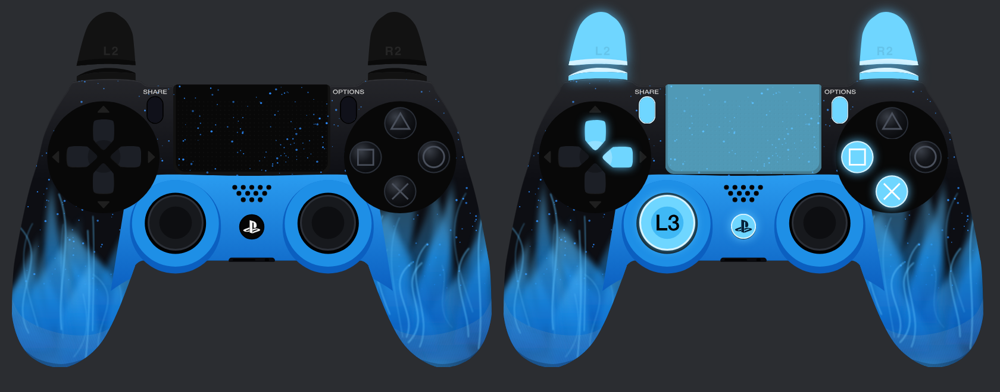

# GPV skins

Custom CSS for the GPV (gamepadviewer) classic DS4 skin.

## Blue Flame

Gloss black shell with blue speckles, a solid blue center and blue flames on the grips. Pressed buttons glow ice blue.



In GPV, open the gamepad, go to Skin, choose DS4 or DS4 White, and paste this into **Edit CSS URL**:

```
https://cdn.jsdelivr.net/gh/syntrx-dev/gpv-skins@main/blue-flame.css
```

`build.py` regenerates the CSS. It expects GPV's stock DS4 art in `ps4-assets/`, downloaded from `https://overlay.gamepadviewer.com/loader/ps4-assets/`.
